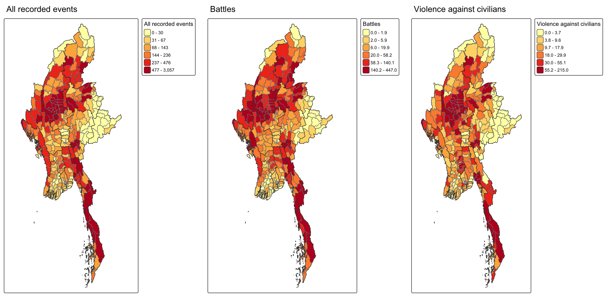
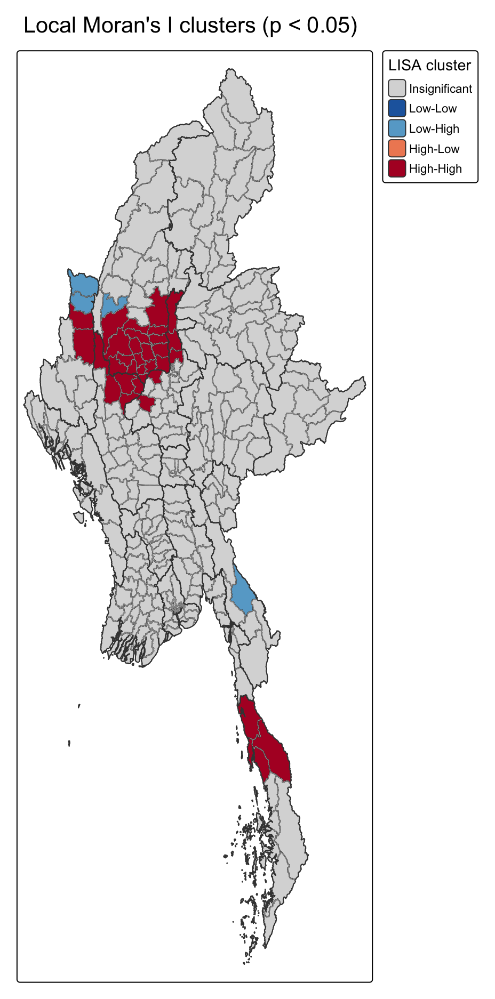
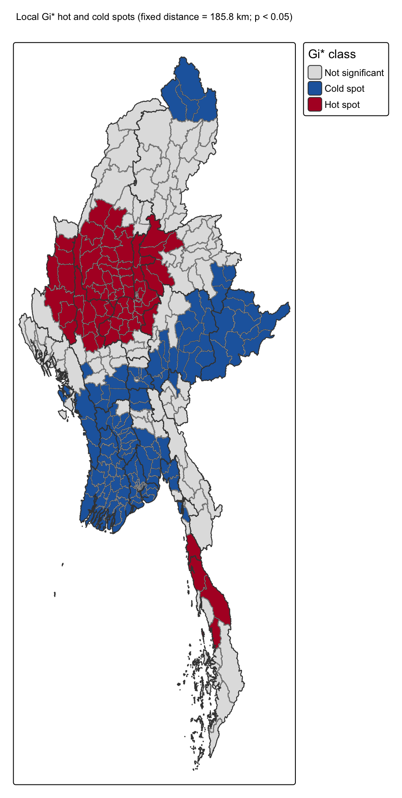
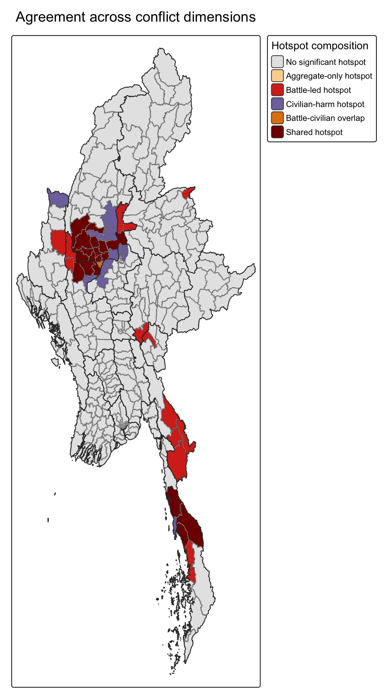
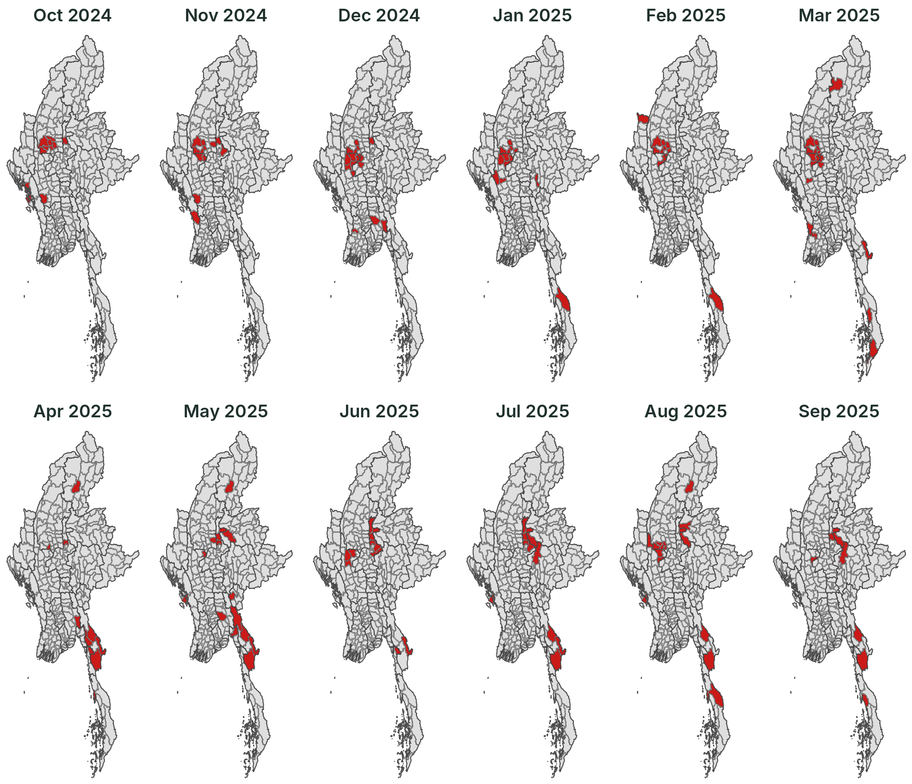
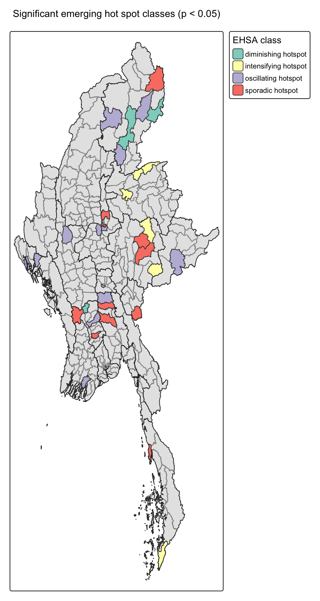
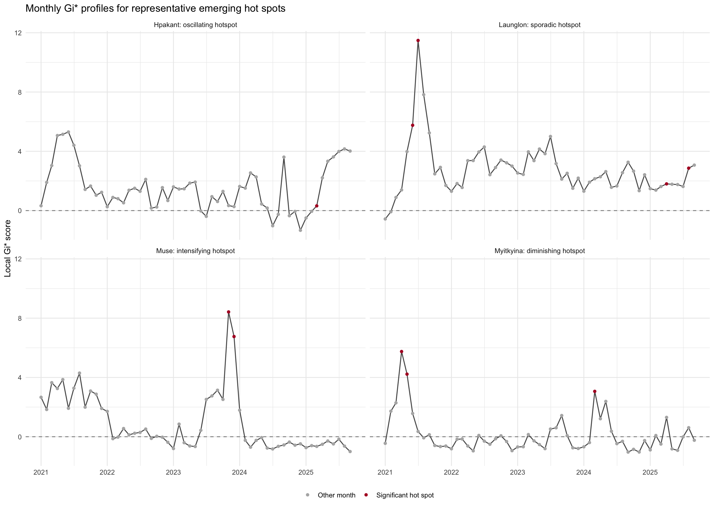

## Contents {.toc-slide}

::: {.grid .g-3 .toc}
::: card
[01]{.n}
[Research question]{.t}
[Why township-level hotspots matter for peace-building]{.d}
:::

::: card
[02]{.n}
[Study area and data]{.t}
[ACLED events, MIMU townships, data-quality gates]{.d}
:::

::: card
[03]{.n}
[Analytical approach]{.t}
[From a space-time cube to LISA, Gi\* and EHSA]{.d}
:::

::: card
[04]{.n}
[Key findings]{.t}
[Where conflict clusters, what drives it, how it moves, how it trends]{.d}
:::

::: card
[05]{.n}
[Public-safety implications]{.t}
[Turning hotspot types into monitoring priorities]{.d}
:::

::: card
[06]{.n}
[Limitations]{.t}
[What the evidence can and cannot support]{.d}
:::
:::

## [01 · Research question]{.kicker}Where does armed conflict concentrate, and is it moving?

::: question
Where do recorded conflict events form significant local clusters, and which township hotspots **persist, emerge, intensify or weaken** through time?
:::

::: {.grid .g-4}
::: {.card .accent .stat}
[87,103]{.num}
[ACLED events recorded in the study period]{.lbl}
:::

::: {.card .accent .stat}
[330]{.num}
[Myanmar townships (MIMU Admin-3)]{.lbl}
:::

::: {.card .accent .stat}
[57]{.num}
[monthly time steps, Jan 2021 – Sep 2025]{.lbl}
:::

::: {.card .accent .stat}
[18,810]{.num}
[township-months in a complete space-time cube]{.lbl}
:::
:::

::: band
**Why it matters.** Myanmar's post-2021 conflict is geographically uneven. A national total hides *where* violence concentrates and *how* that concentration shifts, which is exactly what peace-building and humanitarian teams need in order to decide where to look first.
:::

## [02 · Study area and data]{.kicker}A township-level view of Myanmar, 2021–2025

::: {.grid .center-v style="grid-template-columns: 1.55fr 1fr;"}
::: figure
{style="height:470px"}

::: cap
Total recorded events by township, Jan 2021 – Sep 2025 (quantile classes within each map)
:::
:::

::: {.rows}
::: card
[Inputs]{.ct}

- **ACLED** event points: date, type, coordinates, fatalities
- **MIMU** Admin-3 township boundaries, P-code v9.4
- Projected working copy in **EPSG:6933** for geometry
:::

::: {.card .soft}
[Data-quality gates]{.ct}

- 0 duplicate IDs, 0 missing dates or coordinates
- 1,112 events missing a township name → assigned by **coordinates**
- Only **9 of 87,103** points fall outside any township
- Zero-event months kept as **observed zeros**
:::
:::
:::

::: small
The burden is highest in the **Sagaing–Magway dry zone** (Yinmarbin 3,057 · Salingyi 2,038 · Kale 2,009 events), while battles peak in **Shan and Kayin** (Nawnghkio 447 · Kawkareik 441) and civilian harm also stands out in Myingyan (Mandalay) and Hpakant (Kachin).
:::

## [03 · Analytical approach]{.kicker}From event points to hotspot trajectories

::: pipeline
::: step
[1]{.no}
[Prepare & match]{.tt}
[Clean ACLED fields, audit precision, assign every event to a township P-code by spatial join.]{.dd}
[→ township event table]{.out}
:::

::: step
[2]{.no}
[Space-time cube]{.tt}
[Count events per township-month and complete all 330 × 57 combinations.]{.dd}
[→ regular monthly series]{.out}
:::

::: step
[3]{.no}
[Local association]{.tt}
[Local Moran's I separates clusters from outliers; local Gi\* finds high- and low-value concentrations.]{.dd}
[→ LISA & Gi\* maps]{.out}
:::

::: step
[4]{.no}
[Conflict composition]{.tt}
[Repeat Gi\* for all events, battles and violence against civilians under one rule.]{.dd}
[→ hotspot agreement map]{.out}
:::

::: step
[5]{.no}
[Change through time]{.tt}
[Monthly Gi\* maps, Mann-Kendall trends and Emerging Hot Spot Analysis.]{.dd}
[→ EHSA hotspot classes]{.out}
:::
:::

::: chips
[**Weights** · Queen contiguity, row-standardised]{.chip}
[**Gi\* band** · fixed 185.8 km]{.chip}
[**Permutations** · 99, seed 626]{.chip}
[**Decision rule** · p \< 0.05, with BH-adjusted check]{.chip}
[**Software** · R: sf, sfdep, tmap, Kendall]{.chip}
:::

::: {.grid .g-3 style="margin-top:26px;"}
::: {.card .teal}
[Local Moran's I asks]{.ct}

Is a township **similar to or different from** its neighbours? It finds clusters (High-High) and outliers (Low-High).
:::

::: {.card .teal}
[Local Gi\* asks]{.ct}

Is this area a **significant concentration** of high (hotspot) or low (cold spot) event counts?
:::

::: {.card .teal}
[EHSA asks]{.ct}

How has each township's Gi\* **changed across 57 months**: intensifying, oscillating, sporadic or diminishing?
:::
:::

## [04 · Key findings]{.kicker}Finding 1: Conflict clusters in the dry zone and the far south

::: {.grid style="grid-template-columns: 1fr 1fr 1.15fr;"}
::: figure
{style="height:630px"}

::: cap
Local Moran's I, Queen contiguity · red = High-High, light blue = Low-High
:::
:::

::: figure
{style="height:630px"}

::: cap
Local Gi\*, 185.8 km band · red = hotspot, blue = cold spot
:::
:::

::: rows
::: {.card .accent .stat}
[34]{.num}
[**High-High clusters** (Local Moran's I), centred on Sagaing–Magway and Tanintharyi]{.lbl}
:::

::: {.card .accent .stat}
[4]{.num}
[**Low-High outliers**: quieter townships surrounded by high-conflict neighbours]{.lbl}
:::

::: {.card .accent .stat}
[78 / 148]{.num}
[**Gi\* hotspots / cold spots** at a 185.8 km band; 67 hotspots survive BH adjustment]{.lbl}
:::
:::
:::

## [04 · Key findings]{.kicker}Finding 2: The same hotspot can mean different kinds of violence

::: {.grid style="grid-template-columns: 0.75fr 1.25fr;"}
::: figure
{style="height:650px"}
:::

::: {}
::: {.rows}
```{=html}
<div class="row"><div class="big" style="color:#6a0001">19</div><div><span class="name"><span class="sw" style="background:#6a0001"></span>Shared hotspot</span><span class="desc">Hot for all events, battles <em>and</em> civilian violence: Yinmarbin, Salingyi, Monywa, Myaing, Yesagyo, Pauk.</span></div></div>
```

```{=html}
<div class="row"><div class="big" style="color:#cb1b19">14</div><div><span class="name"><span class="sw" style="background:#cb1b19"></span>Battle-led hotspot</span><span class="desc">Armed confrontation dominates, mainly in Kayin, Magway and Mandalay.</span></div></div>
```

```{=html}
<div class="row"><div class="big" style="color:#6c5d9c">13</div><div><span class="name"><span class="sw" style="background:#6c5d9c"></span>Civilian-harm hotspot</span><span class="desc">Violence against civilians stands out, mainly in Mandalay, Sagaing and Chin.</span></div></div>
```

```{=html}
<div class="row"><div class="big" style="color:#d96d10">1</div><div><span class="name"><span class="sw" style="background:#d96d10"></span>Battle-civilian overlap</span><span class="desc">Hot for both specific types but not for the aggregate count (Sagaing).</span></div></div>
```
:::

::: band
**Takeaway.** An aggregate hotspot map says *where*; the three-way comparison says *what kind* of violence drives it. Battle-led and civilian-harm areas call for different responses.
:::
:::
:::

## [04 · Key findings]{.kicker}Finding 3: Hotspots move month to month

::: {.grid style="grid-template-columns: 1.3fr 1fr;"}
::: figure
{style="height:610px"}

::: cap
Significant monthly Gi\* hotspots (red), Oct 2024 – Sep 2025, Queen contiguity
:::
:::

::: rows
::: card
[The last 12 months]{.ct}

- **Oct 2024 – Mar 2025:** the Sagaing–Magway dry-zone corridor holds the main concentration.
- **Apr – May 2025:** the focus shifts south-east to **Kayin**.
- **Jun – Sep 2025:** it moves toward **Mandalay**, partly returns to the dry zone, then fragments.
:::

::: {.card .soft}
[Most persistent townships]{.ct}

**7 of 12 months:** Salingyi, Monywa, Pale, Singu<br>
**6 of 12 months:** Pakokku, Myaing, Budalin, Yesagyo
:::

::: {.band style="margin-top:0"}
The widest spread in the full 57 months was **April 2023**, with **30** hotspot townships at once.
:::

:::
:::

## [04 · Key findings]{.kicker}Finding 4: Four different hotspot trajectories

::: {.grid style="grid-template-columns: 0.85fr 1fr 1.25fr;"}
::: figure
{style="height:660px"}
:::

::: rows
```{=html}
<div class="row"><div class="big" style="color:#7a6fb0">13</div><div><span class="name"><span class="sw" style="background:#b0aad1"></span>Oscillating</span><span class="desc">Repeated reversals: Hpakant, Rathedaung, Mrauk-U, Sintgaing</span></div></div>
```

```{=html}
<div class="row"><div class="big" style="color:#d9483d">11</div><div><span class="name"><span class="sw" style="background:#f7695f"></span>Sporadic</span><span class="desc">On-off episodes: Phyu, Taungoo, Madaya, Laihka</span></div></div>
```

```{=html}
<div class="row"><div class="big" style="color:#9a8a00">7</div><div><span class="name"><span class="sw" style="background:#ffffa4"></span>Intensifying</span><span class="desc">Rising Gi*: Muse, Namhkan, Namhsan, Kyethi, Kawthoung</span></div></div>
```

```{=html}
<div class="row"><div class="big" style="color:#2f8f80">3</div><div><span class="name"><span class="sw" style="background:#7dcbbb"></span>Diminishing</span><span class="desc">Falling Gi*: Chipwi, Myitkyina, Pyay</span></div></div>
```

::: xsmall
34 significant classes at p \< 0.05; 29 remain after BH adjustment.
:::
:::

::: figure
{style="height:520px"}

::: cap
Monthly Gi\* profiles. Top: **Hpakant** (oscillating), **Launglon** (sporadic). Bottom: **Muse** (intensifying), **Myitkyina** (diminishing). Red points = significant hotspot months.
:::
:::
:::

## [05 · Public-safety implications]{.kicker}Turning hotspot types into monitoring priorities

```{=html}
<table class="impl">
  <thead>
    <tr><th>Hotspot signal</th><th>Recommended response</th><th>Why</th></tr>
  </thead>
  <tbody>
    <tr><td>Recurring recent hotspots<br><span style="font-weight:400;color:#66747b">Salingyi, Monywa, Pale, Singu</span></td><td>Sustained township-level review</td><td>Hotspot in 7 of the last 12 months: the concentration keeps coming back, it is not a one-off spike.</td></tr>
    <tr><td>Intensifying hotspots<br><span style="font-weight:400;color:#66747b">Northern &amp; southern Shan, Kawthoung</span></td><td>Field verification and closer monitoring</td><td>Local concentration is still rising, so the situation may be getting worse.</td></tr>
    <tr><td>Sporadic &amp; oscillating hotspots<br><span style="font-weight:400;color:#66747b">Kachin, Rakhine, Bago, Mandalay</span></td><td>Flexible, event-triggered monitoring</td><td>Violence disappears and returns, so a fixed long-run ranking would miss flare-ups.</td></tr>
    <tr><td>Civilian-harm hotspots<br><span style="font-weight:400;color:#66747b">Mandalay, Sagaing, Chin</span></td><td>Protection-focused programming</td><td>Recorded violence targets civilians directly, not only armed actors.</td></tr>
    <tr><td>Diminishing hotspots<br><span style="font-weight:400;color:#66747b">Chipwi, Myitkyina, Pyay</span></td><td>Follow-up before de-prioritising</td><td>A falling statistic does not prove that present-day harm is low.</td></tr>
  </tbody>
</table>
```

::: band
These maps are a **screening tool**, not a final decision. Field action should also weigh population exposure, displacement, access conditions and consultation with affected communities.
:::

## [06 · Limitations]{.kicker}What the evidence can and cannot support

::: {.grid .g-3}
::: {.card .accent}
[Data]{.ct}

- ACLED records reflect **reporting access**; remote or restricted areas may be under-recorded.
- Event counts measure **recorded burden**, not population risk.
- 9 events could not be placed in a township.
:::

::: {.card .accent}
[Method]{.ct}

- Township boundaries and monthly bins **shape** the clusters (MAUP).
- With 99 permutations, p cannot fall below ~0.01, which limits **BH resolution** across 330 tests.
- The 185.8 km Gi\* band smooths broadly; Queen weights follow immediate neighbours.
:::

::: {.card .accent}
[Interpretation]{.ct}

- Results show **where and when** concentration occurs, not **why**.
- The 12-month maps are a display window; EHSA uses the full 57 months.
- Nominal p \< 0.05 follows the course workflow; BH counts are a stricter check.
:::
:::

::: {.card .soft style="margin-top:22px;"}
**Reproducible workflow.** The Quarto technical report runs end-to-end with a fixed seed (626) and records data sources, CRS, parameters and every analytical decision.<br>
**Technical report:** [Geospatial Analytics for Peace](take-home-exercise2.html) · **Code:** [github.com/sabrinahao99/ISSS626-GEO](https://github.com/sabrinahao99/ISSS626-GEO)
:::
